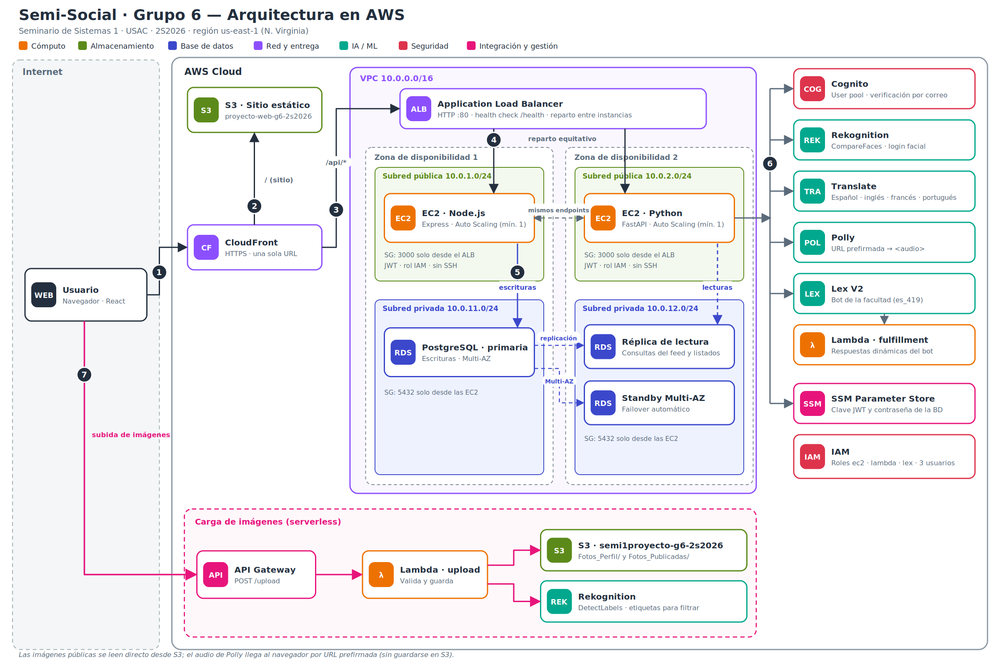

# Semi-Social — Grupo 6

Seminario de Sistemas 1 · Segundo semestre 2026 · Universidad de San Carlos de Guatemala, Facultad de Ingeniería (ECYS)

Red social desplegada completamente en AWS. Permite registrarse y entrar con contraseña o con el rostro, publicar imágenes que se etiquetan automáticamente, dar me gusta y comentar, traducir y escuchar los textos, agregar amigos, chatear y consultar un bot de la facultad.

## 1. Datos de los estudiantes

| Carné | Nombre completo | Rol en el proyecto |
|-------|-----------------|--------------------|
| _202003948_ | _Carlos Alfredo Barrientos López_ | _infraestructura y despliegue_ |

Repositorio: `SEMINARIO1_A_2S2026_G6` · Colaboradores: `elder1095`, `CarlosJezeh777`

## 2. Arquitectura

_Versión vectorial editable: [`docs/arquitectura.svg`](docs/arquitectura.svg)._

### Flujo de una petición (números del diagrama)

1. **Usuario → CloudFront.** El navegador abre una única URL HTTPS: `https://d22cqesgkv5aqa.cloudfront.net`. Con HTTPS el navegador permite usar la cámara (registro y login facial).
2. **CloudFront → S3 (sitio).** La ruta `/` entrega el frontend React (archivos estáticos) desde el bucket `proyecto-web-g6-2s2026`.
3. **CloudFront → ALB.** Las rutas `/api/*` se envían al Application Load Balancer. Como sitio y API comparten dominio, no hay problemas de CORS ni de contenido mixto.
4. **ALB → EC2.** El balanceador reparte el tráfico entre dos instancias en zonas de disponibilidad distintas: una con **Node.js/Express** y otra con **Python/FastAPI**. Ambas exponen los mismos endpoints y comparten la clave JWT, de modo que un token emitido por una sirve en la otra. El health check usa `/health`.
5. **EC2 ↔ RDS.** Los backends usan dos conexiones: las **escrituras** van a la instancia primaria de PostgreSQL (Multi-AZ) y las **lecturas** del feed van a la **réplica de lectura**. No hay bases de datos locales ni en contenedores.
6. **EC2 → servicios administrados** (con el rol IAM de las instancias): Cognito (registro, verificación por correo y login), Rekognition `CompareFaces` (login facial), Translate (es, en, fr, pt), Polly (devuelve una URL prefirmada que el navegador reproduce con `<audio>`, sin guardar mp3 en S3) y Lex (bot de la facultad, con una Lambda de respuestas dinámicas). La contraseña de la base de datos y la clave JWT se leen de **SSM Parameter Store**.
7. **Subida de imágenes (serverless).** Toda foto de perfil o publicación pasa por **API Gateway → Lambda → S3** (`Fotos_Perfil/` y `Fotos_Publicadas/`). En las publicaciones, la Lambda también llama a Rekognition `DetectLabels`; las etiquetas obtenidas se guardan en la base de datos y alimentan el filtro y el buscador.

### Funcionalidades y servicios que las sostienen

| Funcionalidad | Servicios |
|---------------|-----------|
| Registro con verificación por correo, login por contraseña | Cognito, backend, RDS |
| Login facial | Rekognition (`CompareFaces`) contra la foto de perfil en S3 |
| Publicaciones con imagen, filtro y buscador de etiquetas | API Gateway, Lambda, S3, Rekognition (`DetectLabels`), RDS |
| Comentarios y me gusta (solo propios o de amigos) | Backend, RDS |
| Traducir y escuchar | Translate, Polly (URL prefirmada) |
| Amistades con solicitudes (aceptar o rechazar) | Backend, RDS |
| Chat entre amigos | Backend, RDS (el cliente consulta cada 2.5 s) |
| Bot de la facultad | Lex, Lambda |

### Alta disponibilidad

- ALB en dos zonas de disponibilidad con health check; si una instancia falla, deja de recibir tráfico.
- Cada backend está en un **Auto Scaling Group** (mínimo 1) con chequeo de salud del balanceador: una instancia caída se reemplaza sola.
- RDS en **Multi-AZ** (failover automático) más una réplica de lectura.
- Las actualizaciones de código se publican con _instance refresh_: primero levanta la instancia nueva y después retira la anterior.

### Seguridad

- **Grupos de seguridad encadenados:** internet → ALB (80) → EC2 (3000, solo desde el ALB) → RDS (5432, solo desde las EC2).
- **Sin SSH:** el acceso administrativo a las EC2 es por SSM Session Manager. Las instancias exigen IMDSv2 y tienen el disco cifrado.
- **JWT** en todos los endpoints del backend, excepto registro, confirmación, login y `/health`.
- **Secretos** fuera del código, en SSM Parameter Store (SecureString).
- **S3:** lectura pública solo sobre `Fotos_Perfil/*` y `Fotos_Publicadas/*` del bucket de imágenes.

### Recursos desplegados (us-east-1)

| Recurso | Nombre / valor |
|---------|----------------|
| Sitio (CloudFront) | `https://d22cqesgkv5aqa.cloudfront.net` |
| Bucket del sitio | `proyecto-web-g6-2s2026` |
| Bucket de imágenes | `semi1proyecto-g6-2s2026` |
| Balanceador | `semi-g6-alb-1769217202.us-east-1.elb.amazonaws.com` |
| Auto Scaling Groups | `semi-g6-node-asg`, `semi-g6-python-asg` |
| RDS PostgreSQL | `semi-g6-db` (primaria Multi-AZ), `semi-g6-db-replica` |
| Cognito | user pool `us-east-1_DMqeoJslG` |
| Lex | bot `semi-g6-bot` (alias `prod`, `es_419`) |
| Lambda | `semi-g6-upload`, `semi-g6-lex-fulfillment` |
| API Gateway | `semi-g6-api` → `POST /upload` |

> Los nombres de bucket llevan el sufijo `-2s2026` porque `semi1proyecto-g6` y `proyecto-web-g6` ya estaban tomados por otra cuenta (los nombres de S3 son únicos en todo AWS).

## 3. Usuarios, roles y permisos IAM

| Identidad | Tipo | Permisos |
|-----------|------|----------|
| `semi-g6-ec2-role` (perfil `semi-g6-ec2-profile`) | Rol de las EC2 | `AmazonSSMManagedInstanceCore`. Política `servicios-app`: Polly `SynthesizeSpeech`; Translate `TranslateText`; Rekognition `DetectLabels` y `CompareFaces`; Lex `RecognizeText`; Comprehend `DetectDominantLanguage`; S3 `GetObject`/`PutObject` solo en el bucket de imágenes; SSM `GetParameter` solo en `/semisocial/g6/*`; Cognito `AdminGetUser`, `AdminUpdateUserAttributes`, `AdminInitiateAuth`, `AdminSetUserPassword` sobre el pool |
| `semi-g6-lambda-role` | Rol de las Lambdas | `AWSLambdaBasicExecutionRole`. Política `s3-rekognition`: S3 `PutObject`/`GetObject` solo en `Fotos_Perfil/*` y `Fotos_Publicadas/*`; Rekognition `DetectLabels` y `CompareFaces` |
| `semi-g6-lex-role` | Rol del bot | Polly `SynthesizeSpeech` |
| `semi-g6-s3` | Usuario IAM | `s3:*` solo sobre los dos buckets del proyecto |
| `semi-g6-ec2` | Usuario IAM | `AmazonEC2FullAccess` y `ElasticLoadBalancingFullAccess` |
| `semi-g6-rds` | Usuario IAM | `AmazonRDSFullAccess` |

Cada servicio tiene su propio usuario o rol, de modo que ninguna identidad tiene más permisos de los que necesita (separación de responsabilidades).

### Grupos de seguridad

| Grupo | Entrada permitida |
|-------|-------------------|
| `semi-g6-alb` | TCP 80 desde internet |
| `semi-g6-ec2` | TCP 3000 **solo** desde `semi-g6-alb` |
| `semi-g6-rds` | TCP 5432 **solo** desde `semi-g6-ec2` |

## 4. Capturas de pantalla

### Buckets de S3

### EC2

### Base de datos RDS

### Aplicación web
##### El inicio de nuestra Página

##### La página de registro

##### Ver la interfaz de la aplicación

##### Ver las publicaciones y la traducción de audio

##### Apartado de Mensajeria

##### Realizar una Publicación

##### Aceptar o Rechazar Solicitudes de amistad

##### Interacción con el Bot

##### Chats con amistades

##### Realizar comentarios

##### Utilizar etiquetas para busqueda

##### Mi perfil

##### Enviar Solicitudes

##### Comenzar a chatear

### Funciones Lambda

### Pool de Cognito

### Configuración de Amazon Lex

### Balanceador de carga

