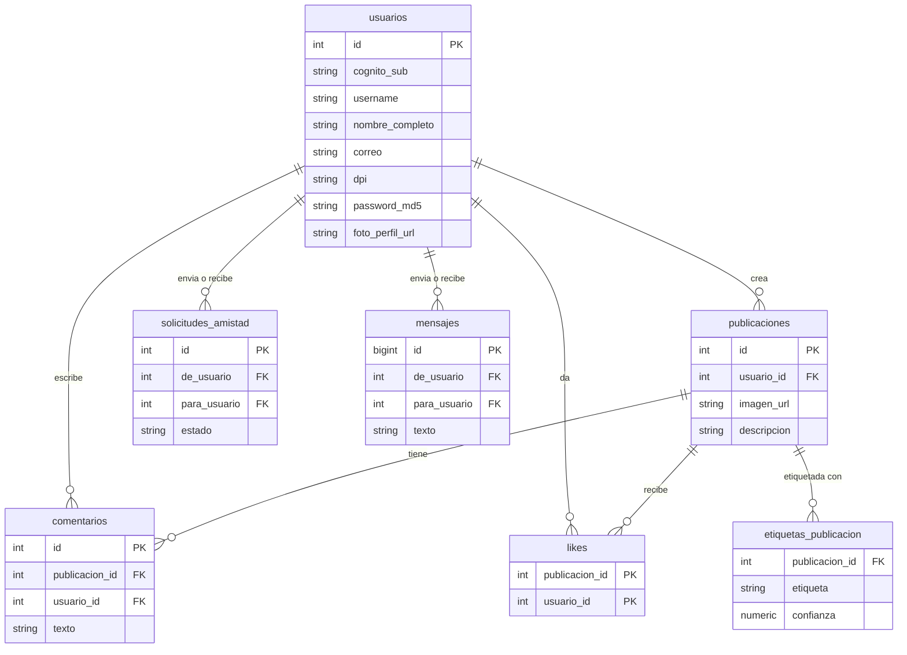
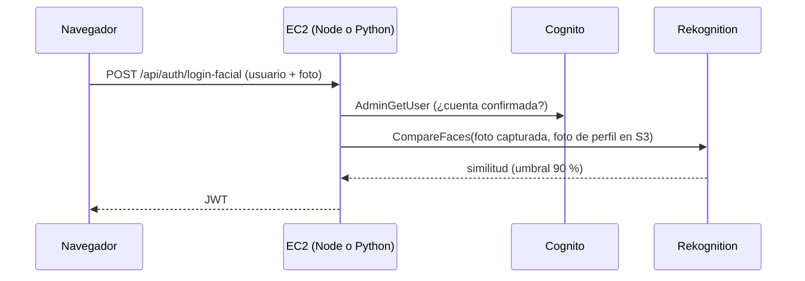
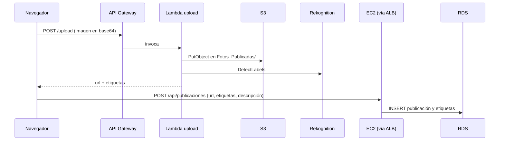
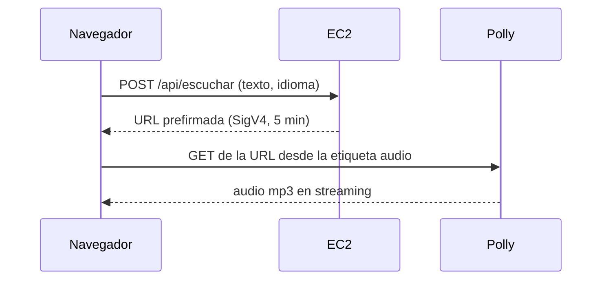

# Guía técnica — Semi-Social (Grupo 6)

Material de apoyo para la calificación. El manual oficial es el `README.md`; esta guía amplía el detalle técnico.

## 1. Endpoints

Todos los endpoints `/api/*` van por el balanceador y exigen `Authorization: Bearer <JWT>`, salvo los marcados como públicos. Node y Python implementan exactamente lo mismo.

| Método | Ruta | Descripción |
|--------|------|-------------|
| GET | `/health` | Chequeo del balanceador (público) |
| GET | `/api/info` | Servidor que respondió: `node` o `python` (público) |
| POST | `/api/auth/register` | Registro en Cognito y RDS (público) |
| POST | `/api/auth/confirm` | Verifica el correo con el código (público) |
| POST | `/api/auth/login` | Login con usuario y contraseña (público) |
| POST | `/api/auth/login-facial` | Login con rostro, `CompareFaces` (público) |
| GET / PUT | `/api/me` | Ver y editar perfil (pide la contraseña para guardar) |
| GET | `/api/usuarios/no-amigos` | Usuarios que aún no son amigos |
| GET | `/api/amigos` | Lista de amigos |
| POST | `/api/amigos/solicitudes` | Enviar solicitud de amistad |
| GET | `/api/amigos/solicitudes` | Solicitudes recibidas |
| POST | `/api/amigos/solicitudes/:id/responder` | Aceptar o rechazar |
| POST | `/api/publicaciones` | Crear publicación (URL de imagen + etiquetas) |
| GET | `/api/publicaciones` | Feed propio y de amigos; filtros `etiqueta`, `buscar`, `fresh` |
| GET | `/api/etiquetas` | Etiquetas disponibles para filtrar |
| POST | `/api/publicaciones/:id/comentarios` | Comentar (autor y sus amigos) |
| POST | `/api/publicaciones/:id/like` | Me gusta (alterna) |
| POST | `/api/traducir` | Translate: `texto`, `origen`, `destino` |
| POST | `/api/escuchar` | URL prefirmada de Polly |
| GET / POST | `/api/chat/:amigoId` | Mensajes (`?desde=<id>`) y envío |
| POST | `/api/bot` | Pregunta al bot de Lex |
| POST | `/upload` | **API Gateway → Lambda**: sube imagen a S3 (público) |

## 2. Modelo de datos (PostgreSQL)



`amigos` es una vista: las solicitudes con estado `aceptada`, en ambos sentidos.

## 3. Flujos

### Login facial


### Publicar una imagen


### Escuchar un texto (Polly sin guardar archivos)


## 4. Despliegue (AWS CLI)

Los scripts están en la raíz de `Proyecto/`. Se guardan los IDs de lo creado en `.state.env`.

```bash
export DB_PASS='<contraseña>'
bash deploy.sh                          # 01 red · 02 IAM · 03 S3 · 04 RDS · 05 Cognito · 06 EC2+ALB · 07 API Gateway+Lambda · 08 Lex
bash 09-schema.sh                       # tablas en RDS
bash redeploy.sh node && bash redeploy.sh python
bash 10-cloudfront.sh
bash 11-frontend.sh
```

Para borrar todo y dejar de generar costos: `bash destroy.sh`.

## 5. Pruebas de alta disponibilidad

1. `curl https://<dominio>/api/info` varias veces: alterna entre `node` y `python`.
2. Detener una EC2 desde la consola: la aplicación sigue respondiendo y el Auto Scaling Group lanza el reemplazo.
3. Ver el target group del balanceador: las dos instancias en estado _healthy_.

## 6. Preguntas frecuentes de la calificación

**¿Por qué hay dos backends distintos?** El enunciado pide dos EC2 con los mismos endpoints, una en Node.js y otra en Python. Comparten la clave JWT (guardada en SSM), así que un token emitido por una sirve en la otra.

**¿Cómo reparte el tráfico el balanceador?** Round-robin entre las instancias sanas. El health check consulta `/health` cada 10 s; tras dos fallos seguidos, la instancia sale del reparto.

**¿Qué pasa si se cae una EC2?** El balanceador deja de enviarle tráfico y el Auto Scaling Group lanza una nueva. Mientras tanto la otra instancia atiende todo.

**¿Para qué sirve la réplica de lectura?** Para las consultas del feed y los listados. Las escrituras van a la primaria. Justo después de publicar o comentar el cliente pide `fresh=1`, que lee de la primaria, porque la réplica puede ir unos instantes atrasada.

**¿Cómo se suben las imágenes?** Siempre por API Gateway → Lambda → S3. La Lambda acepta JPEG o PNG de hasta unos 4 MB (límite de una invocación síncrona) y, en publicaciones, llama a Rekognition.

**¿De dónde salen las etiquetas del filtro?** Rekognition `DetectLabels` devuelve etiquetas en inglés con un porcentaje de confianza (máximo 10, mínimo 75 %). Se guardan en `etiquetas_publicacion`; los botones del filtro son las etiquetas distintas de las publicaciones que el usuario puede ver.

**¿Cómo funciona el login facial?** Rekognition `CompareFaces` compara la foto tomada con la foto de perfil guardada en S3; con similitud de 90 % o más, el backend emite el JWT.

**¿Cómo suena Polly sin guardar un mp3?** El backend firma (SigV4) una URL GET al endpoint de `SynthesizeSpeech` y la devuelve; el navegador la reproduce directo con `<audio>`.

**¿Por qué MD5 si ya existe Cognito?** La rúbrica exige guardar las contraseñas con MD5 en RDS. La autenticación real y la verificación del correo las hace Cognito. MD5 no es adecuado para producción; allí se usaría bcrypt o Argon2.

**¿Por qué el chat usa consultas periódicas y no WebSockets?** Con dos instancias distintas detrás del balanceador, dos amigos pueden conectarse a servidores diferentes; sin un bus compartido (Redis, etc.) no se verían los mensajes. Guardando los mensajes en RDS y consultando cada 2.5 s funciona sin importar qué instancia atienda.

**¿Cómo se protegen las instancias?** Grupo de seguridad que solo admite el ALB en el puerto 3000, sin SSH (acceso por SSM), IMDSv2, disco cifrado, rol IAM con permisos mínimos y secretos en SSM Parameter Store.

**¿Por qué CloudFront?** Para servir todo por HTTPS desde un único dominio: el navegador solo permite la cámara en páginas HTTPS, y al ser el mismo origen se evitan problemas de CORS.
